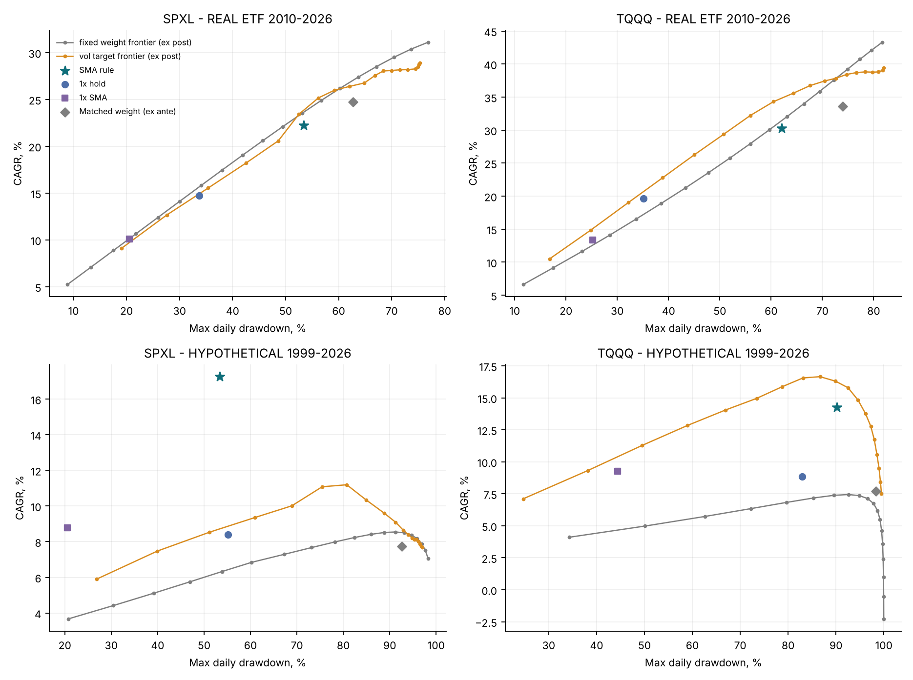

# SMA200 trend filter on 3× leveraged equity ETFs (SPXL, TQQQ) — v4

[简体中文](README_zh.md) · [Paper (PDF)](paper/SMA200_Leveraged_ETF_Research_v4.pdf) · [Word](paper/SMA200_Leveraged_ETF_Research_v4.docx) · [Referee response](REVIEWER_RESPONSE.md) · [Reproduce](REPRODUCE_V4.md) · [Limitations](LIMITATIONS.md)

**Status:** exploratory, reproducible research. Not preregistered and not investment advice.

**Rule.** SPY signal → SPXL and QQQ signal → TQQQ. Buy 20% per day while the signal closes at least 4% above its SMA200 (up to 100%); sell everything after a close more than 3% below the SMA200. Signals are taken at the close and filled at the next open, at 10 bp per fill. Idle cash earns a lagged T-bill rate.

**Data.** One vendor (Yahoo via yfinance; market prices with total-return adjustment) for all four ETFs, through 2026-08-06. The data are validated against an NYSE calendar and reconciled to issuer data.

## Main finding (real ETFs, 2010-02-11 to 2026-08-06)

| | SMA rule | 3× hold | 1× hold (SPY/QQQ) | 1× SMA | Matched weight (ex ante) | Vol target 30% |
|---|---:|---:|---:|---:|---:|---:|
| SPXL CAGR / Max DD | 22.2% / −53.4% | 31.1% / −76.9% | 14.8% / −33.7% | 10.1% / −20.6% | 24.8% / −62.7% | 20.6% / −48.6% |
| SPXL Calmar / Sharpe | 0.416 / 0.700 | 0.405 / 0.760 | 0.438 / 0.804 | 0.491 / 0.737 | 0.395 / 0.739 | 0.423 / 0.702 |
| TQQQ CAGR / Max DD | 30.2% / −62.1% | 43.3% / −81.7% | 19.7% / −35.1% | 13.4% / −25.2% | 33.6% / −74.0% | 26.3% / −45.1% |
| TQQQ Calmar / Sharpe | 0.487 / 0.771 | 0.530 / 0.873 | 0.560 / 0.899 | 0.532 / 0.779 | 0.455 / 0.829 | 0.583 / 0.835 |

* **No statistically significant evidence of timing value.** In a daily path bootstrap that re-runs every rule with identical definitions (1,000 paths), no Sharpe or Calmar difference against SPY/QQQ, the ex-ante matched mix or the vol target is significant (centred two-sided p ≥ 0.35). The drawdown gain over 3× hold is not significant either (p = 0.09–0.33).
* **Multiple testing.** Reality Check / SPA over 45 configurations, volatility-matched: p ≥ 0.77.
* **Walk-forward.** Annual re-selection of parameters (5-year train, 1-year test) does not help SPXL.
* **Versus plain SPY/QQQ.** The rule earns 7–11 pp a year more, with 20–27 pp deeper drawdowns and lower Sharpe and Calmar ratios.
* **Hypothetical 1999–2026 history** (synthetic before inception): the SPXL rule dominates, because it was in cash for most of 2000–02 and 2007–09. For TQQQ, the vol target is better. In leave-one-crisis-out re-simulations, no favourable result survives removing all large crises together with their recoveries.



## Run

```bash
pip install -r requirements.txt     # Python 3.13; pandoc + xelatex for the PDF
# data/raw/{SPY,SPXL,QQQ,TQQQ}.csv are in the replication archive, or run: python scripts/fetch_yahoo.py
./run_all.sh                        # 46 tests → analyses → tables → paper → verify 682 values
```

Older versions are kept in `paper/archive/` and `docs/archive/`.
