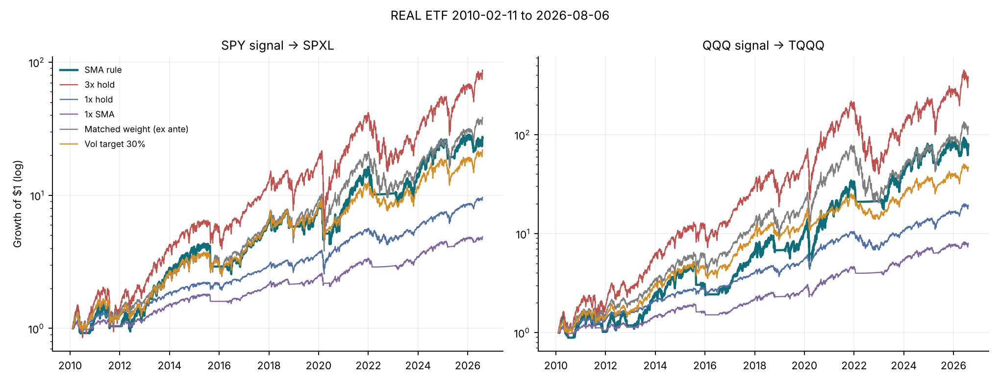
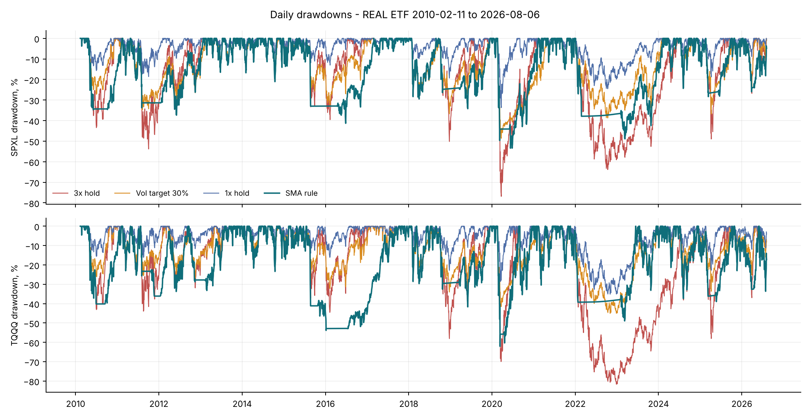
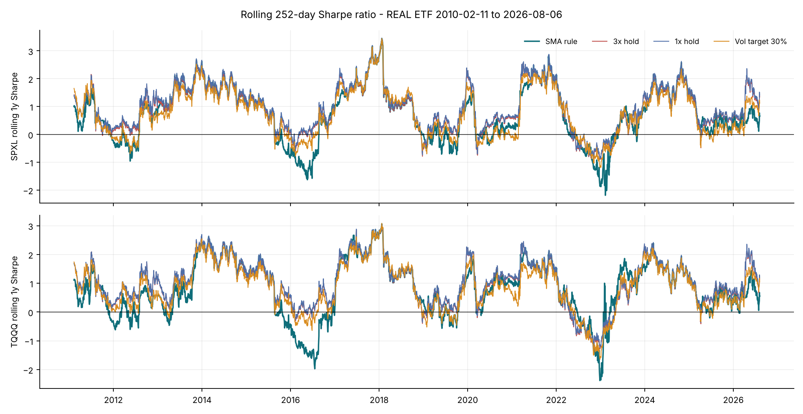
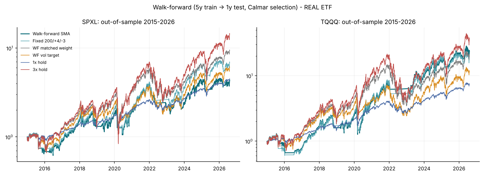
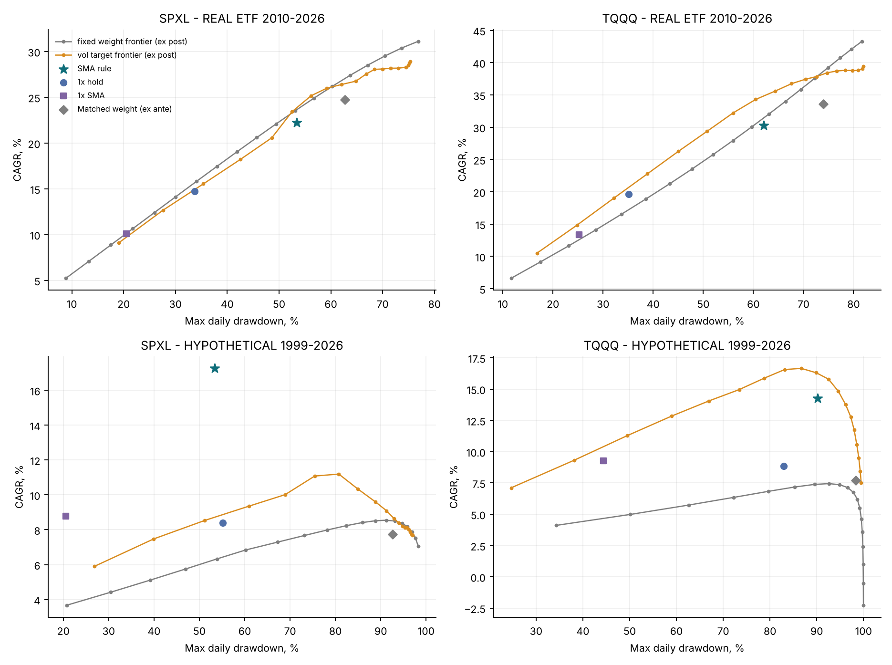
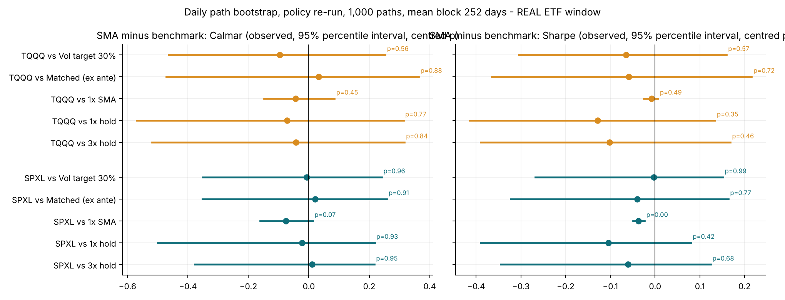
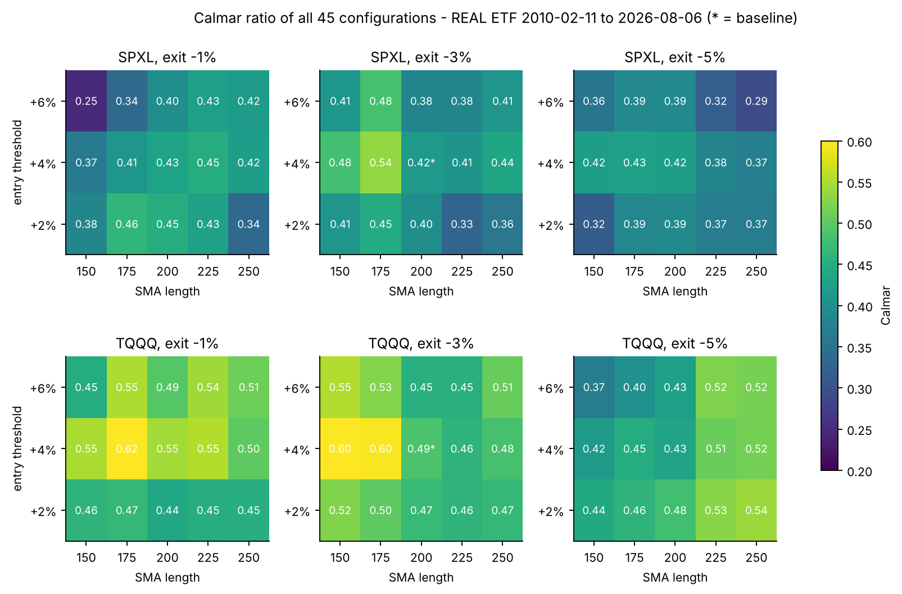
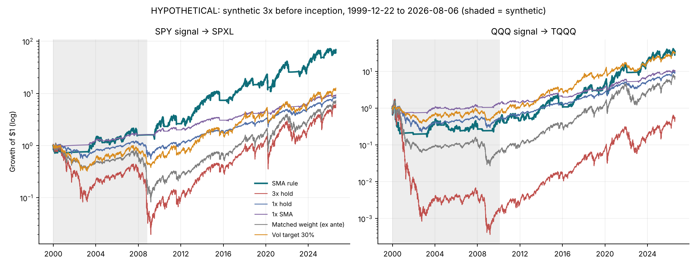

# Abstract

We ask whether a 200-day simple-moving-average (SMA) rule adds market-timing value to 3× daily-reset equity ETFs. Signals from SPY drive SPXL and signals from QQQ drive TQQQ. The rule buys in five 20% stages while the signal ETF closes at least 4% above its SMA and sells everything after a close more than 3% below it. Every order fills at the next open and pays 10 bp. The **primary evidence** is the real-ETF period, 11 February 2010 to 6 August 2026. It uses one vendor's validated, total-return market prices for all four ETFs, which we reconcile against the issuers' published prices and distributions. Idle cash earns a lagged T-bill rate. A partly synthetic 1999–2026 history is reported separately and labelled **hypothetical** throughout.

In the real-ETF record, the rule cuts the maximum drawdown of SPXL from −76.9% to −53.4% and of TQQQ from −81.7% to −62.1%. It earns more than unleveraged SPY or QQQ (22.2% versus 14.8% a year, and 30.2% versus 19.7%). Yet it has a **lower** Sharpe ratio and Calmar ratio than simply holding SPY or QQQ, and than a 30% volatility target. **We find no statistically significant evidence of a timing advantage over any non-timing benchmark.**

Several tests reach this conclusion independently:

* A daily path bootstrap re-runs every rule (with identical definitions) on 1,000 resampled histories. Against unleveraged holdings, the ex-ante exposure-matched mix and volatility targeting, no Sharpe or Calmar difference is significant (centred two-sided p ≥ 0.35).
* White's Reality Check and Hansen's SPA test over all 45 parameter configurations give p ≥ 0.77 once returns are scaled to equal volatility.
* A five-year-train, one-year-test walk-forward selection does not beat the fixed baseline for SPXL. For TQQQ it improves on the fixed baseline, but its Sharpe ratio stays below unleveraged QQQ's.

The drawdown reduction relative to 3× buy-and-hold (23 pp for SPXL, 20 pp for TQQQ) occurs in 84–91% of bootstrap paths, but it is not statistically significant (p = 0.09–0.33). The rule's apparent advantage appears only in the hypothetical history that includes 2000–2002 and 2007–2009. In leave-one-crisis-out re-simulations, the SPXL advantage there survives removing any single crisis, but not removing all four crises with their aftermaths. For the Nasdaq-100, a volatility target matches the rule there with a far smaller drawdown.

The defensible reading is narrow. The filter behaves like insurance against prolonged bear markets, and the post-2010 record contains too few such events to show that the insurance is worth its cost.

**Keywords:** leveraged ETFs; trend following; volatility targeting; walk-forward; Reality Check; SPA; drawdown; replication.

# 1. Introduction and related literature

**Trend timing.** Moving-average rules have been studied since Brock, Lakonishok and LeBaron (1992). Faber (2007) popularised a 10-month rule for asset allocation, and Moskowitz, Ooi and Pedersen (2012) and Hurst, Ooi and Pedersen (2017) document time-series momentum across a century of data. Zakamulin (2014) shows that the real-life performance of moving-average timing is much weaker once realistic out-of-sample procedures and costs are imposed.

**Leveraged ETFs.** Daily-reset funds compound three times the daily return, so their long-run return depends on the path of prices and suffers a variance drag of roughly $(L^2-L)\sigma^2/2$ (Cheng and Madhavan 2009; Avellaneda and Zhang 2010). Gayed and Bilello (2016) combine both ideas: they rotate between leveraged equity and T-bills on a 200-day rule. This paper is an implementation-level replication of that idea.

**Volatility management.** Moreira and Muir (2017) and Harvey et al. (2018) show that scaling exposure by recent volatility improves risk-adjusted equity returns. Cederburg et al. (2020) find that the gains are fragile out of sample. Volatility management is the natural rival explanation for any benefit an SMA filter gives a leveraged fund.

**Data mining.** Sullivan, Timmermann and White (1999) show that the apparent success of technical rules shrinks once one corrects for the universe of rules searched. White (2000), Hansen (2005), Bailey and López de Prado (2014) and Harvey, Liu and Zhu (2016) provide the corresponding tests and thresholds.

This version responds to a third-round review. It adds strict data validation and issuer reconciliation, an audit of the information set behind every decision, ex-ante risk matching, walk-forward selection, leave-one-crisis-out analysis, a 45-configuration grid with Reality Check and SPA tests, cost and cash-vehicle scenarios, tail-risk measures, synthetic-sleeve stress tests, a mechanism decomposition, state-conditional tests, and a direct comparison with plain SPY and QQQ.

# 2. Hypotheses and what each benchmark controls

We state three hypotheses. They were written after earlier drafts had been seen and are **not preregistered**.

* **H1 (drawdown).** The rule has a shallower drawdown than holding the same 3× fund.
* **H2 (timing value).** At comparable exposure or risk, the rule earns more than non-timing allocations.
* **H3 (transport).** The answers are the same for the S&P 500 and the Nasdaq-100 versions.

| Benchmark | What it holds fixed | What a win against it would show |
|:--|:--|:--|
| 3× buy-and-hold | same instrument, full exposure | H1 only: lower risk, at a cost in return |
| 1× buy-and-hold (SPY/QQQ) | no leverage, no timing | that leverage plus timing is worth more than the plain index |
| 1× SMA (rule applied to SPY/QQQ) | same timing, no leverage | whether leverage adds value given the timing |
| Matched weight, **ex ante** | 3× weight equal to the trailing (≤5-year) average of the weights the SMA rule actually held, known at each close and re-set every 21 sessions; the same definition in the main backtest, the bootstrap and the crisis re-runs | timing value beyond lower average exposure |
| Vol target 30% | weight $\min(1,0.30/\hat\sigma_t)$ with trailing 63-day volatility; constant fixed in advance | timing value beyond volatility control |
| Matched weight, ex post † and frontiers | full-sample average weight; families over all weights and vol targets | descriptive only: these use the realised sample |

Earlier drafts compared the rule with a mix calibrated to its own full-sample average weight. That benchmark uses information that would not have been available in real time. It is now kept only as a labelled diagnostic (†). All inferential comparisons use the ex-ante version: its weight is the SMA rule's trailing ≤5-year average weight (0.76 on average), and before one year of history exists it is 0.75.

# 3. Data

## 3.1 Provenance

All four series are daily Yahoo Finance **market-price** bars (Open, High, Low, Close, Adj Close, Volume), exported by `yfinance` with `auto_adjust=False` and obtained from the public repository `hjyssg/tqqq_simulation`. The last common bar is 6 August 2026. The upstream repository does not record the download time, and the author received the files on 12 November 2026. `scripts/fetch_yahoo.py` re-downloads the data and records a UTC timestamp, the yfinance version and SHA-256 hashes. Because Yahoo restates dividend adjustments retroactively, a later download can differ; the audited hashes are listed below and in `data/v4_results/data_manifest.csv`. Raw files are shipped in the replication archive for verification but are not committed to the public repository, because of Yahoo's terms.

| File | First bar | Last bar | Rows | SHA-256 | Fatal checks failed | Warnings |
|:--|--:|--:|--:|--:|--:|--:|
| SPY | 1993-01-29 | 2026-08-06 | 8437 | fbe334492366… | 0 | 2 |
| SPXL | 2008-11-05 | 2026-08-06 | 4464 | 3a360f215c5e… | 0 | 3 |
| QQQ | 1999-03-10 | 2026-08-06 | 6895 | 63f612bf338c… | 0 | 1 |
| TQQQ | 2010-02-11 | 2026-08-06 | 4146 | 8097962b66c3… | 0 | 1 |

## 3.2 Validation

`load_yahoo()` now runs `validate_ohlcv()` before any computation and stops on any fatal failure. Fatal checks are:

* unsorted or duplicate dates, and weekend bars;
* missing values and non-positive prices;
* OHLC inconsistency (Low ≤ Open, Close ≤ High);
* Adj Close above Close, and a one-day adjustment-factor jump above 50%;
* any session missing from, or added to, an NYSE calendar built from explicit holiday rules and the special closures of 1994–2025.

All four files pass every fatal check and match the NYSE calendar exactly; the calendar is also unit-tested on known closures. The warnings are listed in `data_validation.csv`. They include the March 2020 and April 2025 extreme days, and a 13% adjustment-factor change in SPXL on 20 November 2009. On that day the price-only close fell 12.4% while the total-return series fell 0.84% (SPY fell 0.36%), consistent with a large capital-gain distribution. A price-only backtest would have booked that distribution as a loss.

## 3.3 Reconciliation with issuer data; market price versus NAV

| ETF | Item | Issuer value | Yahoo / this study | Result |
|:--|:--|:--|:--|:--|
| SPXL | Inception / first trading day | 2008-11-05 (Direxion) | 2008-11-05 | match |
| SPXL | Market close 2025-02-27 | $163.55 market close; NAV $163.27 (Direxion) | $163.55 | Yahoo = market close, not NAV |
| SPXL | Distribution ex 2024-03-19 | $0.39478 (Direxion) | $0.39500 implied by Adj Close | diff $+0.00022 |
| SPXL | Distribution ex 2024-06-25 | $0.33671 (Direxion) | $0.33702 implied by Adj Close | diff $+0.00031 |
| SPXL | Distribution ex 2024-09-24 | $0.19251 (Direxion) | $0.19296 implied by Adj Close | diff $+0.00045 |
| SPXL | Distribution ex 2024-12-23 | $0.32070 (Direxion) | $0.32100 implied by Adj Close | diff $+0.00030 |
| SPXL | Large distribution 2009-11-20 | not on current issuer page | Close -12.4%, Adj Close -0.84% (SPY -0.36%) | price-only data would book a -12% loss |
| TQQQ | Fund inception | 2010-02-09 (ProShares) | - | - |
| TQQQ | First exchange trading day | 2010-02-11: Nasdaq release "began trading today" (GlobeNewswire, 11 Feb 2010); BATS circular IC 2010-012: UTP from 12 Feb | 2010-02-11 | match; Yahoo first bar = Nasdaq listing day |
| TQQQ | Conflicting issuer statement | ProShares release 10 Feb 2025, fn. 5: performance measured "from first day of trading on Feb 10, 2010", based on NAV | - | treated as NAV/performance start date, not the exchange listing; primary listing source preferred |
| TQQQ | Since-inception total return | 41.02% p.a. NAV, 41.03% market, to 2026-10-31 (ProShares) | sample ends 2026-08-06 | not comparable; reconciliation pending |

Yahoo closes are **exchange market prices, not NAVs**: on 27 February 2025, SPXL's Yahoo close equals Direxion's published market close ($163.55), not its NAV ($163.27). The distributions implied by Yahoo's adjustment factor match Direxion's 2024 distributions to within $0.0005. Sources disagree on TQQQ's first trading day. Nasdaq's listing release, dated 11 February 2010, states that the fund "began trading today"; a BATS circular admits it to unlisted trading from 12 February. A 2025 ProShares release dates performance "from first day of trading on Feb 10, 2010, based on the funds' net asset value", which we read as its NAV start rather than its first exchange session. We follow the contemporaneous listing source: the first exchange trading day is **11 February 2010**, which is also Yahoo's first bar, so no session is missing. (Earlier versions said Yahoo omitted 10 February; that was wrong.) ProShares' published since-inception return is as of 31 October 2026, after our sample ends, so a full total-return reconciliation for TQQQ remains open (§11). All returns here are therefore **market-price total returns**, which is what an investor trading at the open would earn, before tax.

# 4. Strategy and execution protocol

Let $P_t$ be the signal ETF's adjusted close and $M_t=\frac1{200}\sum_{j=0}^{199}P_{t-j}$. After the close of day $t$:

1. if invested and $P_t<0.97M_t$, sell all shares at the open of $t+1$;
2. if flat and $P_t\ge1.04M_t$, buy to a 20% weight at the open of $t+1$;
3. if partly invested, below stage 5, and $P_t\ge1.04M_t$, buy up to the next stage (40%, 60%, 80%, 100%);
4. otherwise, hold. Positions are never trimmed to rebalance.

There is **no intraday stop**: no rule reads High or Low prices, and the only exit is the SMA test on the close. No margin or external borrowing is used; leverage exists only inside the ETF. Fills are fractional. Uninvested cash earns the previous month's 3-month T-bill rate, so the rate is known before it is applied.

| Quantity | Information used | Executed |
|:--|:--|:--|
| SMA signal, stage | closes up to and including $t$ | open $t+1$ |
| Vol-target weight | 63 daily returns ending at close $t$ | open $t+1$, every 5 sessions |
| Ex-ante matched weight | SMA-rule weights up to close $t$ (trailing ≤1,260 days) | open $t+1$, every 21 sessions |
| Walk-forward parameters, matched weight, vol target | the five calendar years before the test year | from the test year's first open |
| Cash rate | DTB3 quote from the previous month | daily accrual |
| Costs | constant, or era and trailing-volatility based (§7.4) | at each fill |

Every rule is also audited automatically. All prices after 29 June 2018 are distorted, every rule is re-run, and every decision and weight up to that date must be identical; every fill price must also equal that day's open. All rules pass:

| ETF | Rule | Decisions before cut unchanged | All fills at that day's open | Orders |
|:--|:--|--:|--:|--:|
| SPXL | SMA rule | yes | yes | 53 |
| SPXL | Vol target 30% | yes | yes | 707 |
| SPXL | Matched weight (ex ante) | yes | yes | 198 |
| SPXL | 1x SMA | yes | yes | 53 |
| SPXL | 3x hold | yes | yes | 1 |
| TQQQ | SMA rule | yes | yes | 70 |
| TQQQ | Vol target 30% | yes | yes | 808 |
| TQQQ | Matched weight (ex ante) | yes | yes | 198 |
| TQQQ | 1x SMA | yes | yes | 70 |
| TQQQ | 3x hold | yes | yes | 1 |

# 5. Hypothetical pre-inception sleeve (secondary evidence only)

Before SPXL (5 November 2008) and TQQQ (11 February 2010) traded, the leveraged sleeve is a daily-reset proxy:

$$L_t=L_{t-1}\left(1+3r_t^{TR}-\frac{2(\tilde r_{f,t}+s)+f}{252}\right).$$

The financing spread $s$ is calibrated on the real funds. It is then validated out of sample: we fit $s$ on 2010–2017 and compare the resulting proxy with the real fund over 2018–2026.

| ETF | Window | Spread s | Check |
|:--|:--|--:|:--|
| SPXL | full real 2010-2026 | 70 bp | residual s.d. 15.5 bp/day |
| SPXL | train 2010-2017 | 59 bp | residual s.d. 15.4 bp/day |
| SPXL | test 2018-2026 (spread from train) | 59 bp | synthetic 25.68% vs real 25.43%; max DD -76.2% vs -76.9%; corr 0.9991 |
| TQQQ | full real 2010-2026 | 75 bp | residual s.d. 18.6 bp/day |
| TQQQ | train 2010-2017 | 38 bp | residual s.d. 16.9 bp/day |
| TQQQ | test 2018-2026 (spread from train) | 38 bp | synthetic 35.96% vs real 35.01%; max DD -81.4% vs -81.7%; corr 0.9991 |

Every result that uses this sleeve is labelled **HYPOTHETICAL**. None of it was investable, and none of it is used for the primary conclusions.

# 6. Primary evidence: the real-ETF record, 2010–2026

## 6.1 Performance and tail risk

| ETF | Rule | CAGR | Max DD | Calmar | Sharpe | ES 99% (daily) | Ulcer | Recovery (days) | Longest underwater (days) | Avg weight | Orders |
|:--|:--|--:|--:|--:|--:|--:|--:|--:|--:|--:|--:|
| SPXL | SMA rule | 22.2% | -53.4% | 0.416 | 0.700 | -9.70% | 0.215 | 170 | 527 | 0.80 | 53 |
| SPXL | 3x hold | 31.1% | -76.9% | 0.405 | 0.760 | -13.09% | 0.221 | 202 | 612 | 1.00 | 1 |
| SPXL | 1x hold | 14.8% | -33.7% | 0.438 | 0.804 | -4.38% | 0.063 | 97 | 488 | 1.00 | 1 |
| SPXL | 1x SMA | 10.1% | -20.6% | 0.492 | 0.737 | -3.24% | 0.071 | 141 | 487 | 0.80 | 53 |
| SPXL | Matched weight, ex ante | 24.8% | -62.7% | 0.395 | 0.739 | -9.54% | 0.173 | 114 | 615 | 0.75 | 198 |
| SPXL | Vol target 30% | 20.6% | -48.6% | 0.423 | 0.702 | -8.10% | 0.170 | 284 | 518 | 0.74 | 707 |
| SPXL | Matched weight, ex post † | 27.3% | -63.4% | 0.430 | 0.772 | -9.89% | 0.169 | 111 | 554 | 0.80 | 198 |
| TQQQ | SMA rule | 30.2% | -62.1% | 0.487 | 0.771 | -11.87% | 0.250 | 115 | 558 | 0.80 | 70 |
| TQQQ | 3x hold | 43.3% | -81.7% | 0.530 | 0.873 | -14.18% | 0.273 | 486 | 762 | 1.00 | 1 |
| TQQQ | 1x hold | 19.7% | -35.1% | 0.560 | 0.899 | -4.80% | 0.087 | 278 | 493 | 1.00 | 1 |
| TQQQ | 1x SMA | 13.4% | -25.2% | 0.531 | 0.779 | -4.06% | 0.091 | 99 | 506 | 0.80 | 70 |
| TQQQ | Matched weight, ex ante | 33.6% | -74.0% | 0.454 | 0.829 | -10.82% | 0.237 | 494 | 770 | 0.75 | 198 |
| TQQQ | Vol target 30% | 26.3% | -45.0% | 0.583 | 0.835 | -7.71% | 0.161 | 287 | 526 | 0.61 | 808 |
| TQQQ | Matched weight, ex post † | 37.4% | -72.0% | 0.520 | 0.876 | -10.90% | 0.221 | 368 | 644 | 0.80 | 198 |

*ES 99% is the mean daily return on the worst 1% of days. Recovery is the number of trading days from the deepest trough back to the previous peak. † Ex post diagnostic.*

{width=100%}

{width=100%}

{width=100%}

The rule reduces maximum drawdown, daily ES99 and recovery time relative to the 3× fund. On risk-adjusted measures it ranks low. For TQQQ, its Calmar is below every benchmark except the ex-ante matched mix, and its Sharpe is the lowest of all seven rules.

Two changes from v3 matter here. First, the ex-ante matched mix (average weight 0.76) has a lower Calmar than the SMA rule for both funds, while the ex-post version used in v3 had a higher one. Part of v3's "the rule is beaten at equal exposure" result therefore came from look-ahead in the benchmark. Second, the matched mix still has the higher Sharpe ratio (0.739 versus 0.700, and 0.829 versus 0.771).

## 6.2 Does the strategy beat simply holding SPY or QQQ?

| ETF | 1x | Measure | SMA rule (3x) | 1x hold | Reading |
|:--|:--|:--|--:|--:|:--|
| SPXL | SPY | CAGR, real 2010-26 | 22.2% | 14.8% | SMA higher |
| SPXL | SPY | Max DD, real | -53.4% | -33.7% | 1x shallower |
| SPXL | SPY | Calmar / Sharpe, real | 0.416 / 0.700 | 0.438 / 0.804 | 1x higher on both |
| SPXL | SPY | Calmar / Sharpe, hypothetical 1999-26 | 0.323 / 0.577 | 0.152 / 0.412 | SMA higher on both |
| SPXL | SPY | Walk-forward OOS 2015-26, Calmar | 0.247 (WF) / 0.341 (fixed) | 0.412 | 1x higher |
| SPXL | SPY | Bootstrap ΔSharpe, observed [95%], p | -0.104 [-0.390, +0.080], p = 0.42 | — | not significant at 5% |
| SPXL | SPY | SPA p, raw / vol-matched return | 0.059 / 1.000 | — | more return; no risk-adjusted superiority |
| TQQQ | QQQ | CAGR, real 2010-26 | 30.2% | 19.7% | SMA higher |
| TQQQ | QQQ | Max DD, real | -62.1% | -35.1% | 1x shallower |
| TQQQ | QQQ | Calmar / Sharpe, real | 0.487 / 0.771 | 0.560 / 0.899 | 1x higher on both |
| TQQQ | QQQ | Calmar / Sharpe, hypothetical 1999-26 | 0.158 / 0.480 | 0.107 / 0.376 | SMA higher on both |
| TQQQ | QQQ | Walk-forward OOS 2015-26, Calmar | 0.506 (WF) / 0.472 (fixed) | 0.541 | 1x higher |
| TQQQ | QQQ | Bootstrap ΔSharpe, observed [95%], p | -0.128 [-0.414, +0.134], p = 0.35 | — | not significant at 5% |
| TQQQ | QQQ | SPA p, raw / vol-matched return | 0.011 / 1.000 | — | more return; no risk-adjusted superiority |

The leveraged rule earns 7–11 pp a year more than the plain index, with roughly 20–27 pp deeper drawdowns. On every risk-adjusted measure in the real-ETF record, plain SPY or QQQ is at least as good. The SPA test finds the higher *raw* return of the SMA configurations over QQQ significant (p = 0.010) and borderline over SPY (p = 0.058). That reflects leverage, not timing: once returns are scaled to equal volatility, p = 1.000. A plain 1× SMA rule has the highest real-window Calmar of all for SPY (0.49). Over 1999–2026, the hypothetical history, the 3× rule beats unleveraged holdings on both measures (§8).

## 6.3 Walk-forward selection

In each test year from 2015, the configuration with the best Calmar (or Sharpe) over the previous five years is chosen from 45 candidates: SMA lengths 150/175/200/225/250, entry +2/+4/+6% and exit −1/−3/−5%. Only the test-year returns are kept. Switching configurations is charged its trading cost. The benchmarks are matched using training-window information only: a constant mix at the selected configuration's training-window average weight, and a volatility target chosen so that its training-window average weight equals the same value.

| ETF | Selection | Rule (OOS 2015-01-02 to 2026-08-06) | CAGR | Max DD | Calmar | Sharpe |
|:--|:--|:--|--:|--:|--:|--:|
| SPXL | Calmar | Walk-forward SMA | 13.5% | -54.8% | 0.247 | 0.479 |
| SPXL | Calmar | Fixed 200/+4/-3 | 18.2% | -53.4% | 0.341 | 0.590 |
| SPXL | Calmar | WF matched weight | 21.4% | -64.6% | 0.332 | 0.630 |
| SPXL | Calmar | WF vol target | 16.9% | -52.4% | 0.324 | 0.561 |
| SPXL | Calmar | 3x hold | 26.0% | -76.9% | 0.338 | 0.667 |
| SPXL | Calmar | 1x hold | 13.9% | -33.7% | 0.412 | 0.708 |
| SPXL | Calmar | 1x SMA | 9.4% | -20.6% | 0.456 | 0.632 |
| SPXL | Sharpe | Walk-forward SMA | 14.8% | -53.8% | 0.274 | 0.510 |
| SPXL | Sharpe | Fixed 200/+4/-3 | 18.2% | -53.4% | 0.341 | 0.590 |
| SPXL | Sharpe | WF matched weight | 22.4% | -64.6% | 0.348 | 0.649 |
| SPXL | Sharpe | WF vol target | 18.5% | -51.1% | 0.361 | 0.597 |
| SPXL | Sharpe | 3x hold | 26.0% | -76.9% | 0.338 | 0.667 |
| SPXL | Sharpe | 1x hold | 13.9% | -33.7% | 0.412 | 0.708 |
| SPXL | Sharpe | 1x SMA | 9.4% | -20.6% | 0.456 | 0.632 |
| TQQQ | Calmar | Walk-forward SMA | 31.4% | -62.1% | 0.506 | 0.766 |
| TQQQ | Calmar | Fixed 200/+4/-3 | 29.3% | -62.1% | 0.472 | 0.733 |
| TQQQ | Calmar | WF matched weight | 29.9% | -76.8% | 0.389 | 0.725 |
| TQQQ | Calmar | WF vol target | 23.7% | -66.6% | 0.357 | 0.653 |
| TQQQ | Calmar | 3x hold | 36.6% | -81.7% | 0.448 | 0.776 |
| TQQQ | Calmar | 1x hold | 19.0% | -35.1% | 0.541 | 0.807 |
| TQQQ | Calmar | 1x SMA | 13.9% | -25.2% | 0.554 | 0.746 |
| TQQQ | Sharpe | Walk-forward SMA | 33.1% | -48.1% | 0.688 | 0.801 |
| TQQQ | Sharpe | Fixed 200/+4/-3 | 29.3% | -62.1% | 0.472 | 0.733 |
| TQQQ | Sharpe | WF matched weight | 30.3% | -76.8% | 0.395 | 0.731 |
| TQQQ | Sharpe | WF vol target | 23.8% | -66.6% | 0.357 | 0.653 |
| TQQQ | Sharpe | 3x hold | 36.6% | -81.7% | 0.448 | 0.776 |
| TQQQ | Sharpe | 1x hold | 19.0% | -35.1% | 0.541 | 0.807 |
| TQQQ | Sharpe | 1x SMA | 13.9% | -25.2% | 0.554 | 0.746 |

| ETF | Selected SMA/entry%/exit% by test year (Calmar criterion) |
|:--|:--|
| SPXL | 2015: 200/+2/-3, 2016: 150/+4/-3, 2017: 150/+4/-5, 2018: 150/+4/-5, 2019: 150/+4/-5, 2020: 175/+4/-1, 2021: 175/+4/-3, 2022: 175/+2/-3, 2023: 175/+4/-3, 2024: 175/+4/-3, 2025: 175/+6/-3, 2026: 150/+6/-3 |
| TQQQ | 2015: 225/+6/-5, 2016: 225/+6/-5, 2017: 250/+4/-3, 2018: 250/+4/-3, 2019: 225/+4/-3, 2020: 225/+4/-3, 2021: 150/+4/-1, 2022: 150/+4/-1, 2023: 150/+4/-1, 2024: 150/+2/-3, 2025: 175/+2/-1, 2026: 175/+2/-1 |

{width=100%}

Re-estimating the parameters every year does not help SPXL: the walk-forward rule's Calmar (0.247) is below the fixed baseline (0.341) and below every benchmark. For TQQQ, Calmar-based selection is slightly better than the fixed rule (0.506 versus 0.472), and Sharpe-based selection gives the highest Calmar of all rules (0.688). Its Sharpe ratio (0.801) is still below plain QQQ (0.807). The selected parameters drift across years (SMA 150–250, exit −1% to −5%), which is what one expects when differences between configurations are mostly noise. The hypothetical 2005–2026 walk-forward is in `walkforward_metrics.csv`.

## 6.4 Equal-risk frontiers (ex post, descriptive)

| Window | ETF | Rule | Fixed: MaxDD | Fixed: ES99 | Fixed: Ulcer | Vol: MaxDD | Vol: ES99 | Vol: Ulcer |
|:--|:--|:--|--:|--:|--:|--:|--:|--:|
| real | SPXL | SMA rule | -1.4 | -4.7 | -8.6 | -1.6 | -3.0 | -3.8 |
| real | SPXL | 1x hold | -0.9 | -0.2 | +1.7 | -0.2 | +2.0 | +5.1 |
| real | SPXL | 1x SMA | -0.0 | -1.5 | -4.1 | +0.4 | +0.1 | -0.4 |
| full | SPXL | SMA rule | +11.0 | +8.7 | +10.3 | +8.5 | +6.2 | +8.4 |
| full | SPXL | 1x hold | +2.0 | +1.4 | +2.2 | -0.5 | +0.2 | +0.6 |
| full | SPXL | 1x SMA | — | +3.2 | +4.6 | — | +2.4 | — |
| real | TQQQ | SMA rule | -1.2 | -9.2 | -10.7 | -4.6 | -6.8 | -7.4 |
| real | TQQQ | 1x hold | +2.4 | +0.1 | +3.0 | -1.0 | +1.9 | +3.9 |
| real | TQQQ | 1x SMA | +0.8 | -3.6 | -4.0 | -1.7 | -2.0 | -3.1 |
| full | TQQQ | SMA rule | +6.9 | +9.8 | +6.8 | -2.0 | +2.8 | -0.1 |
| full | TQQQ | 1x hold | +1.8 | +1.6 | +2.0 | -7.7 | -4.3 | -7.7 |
| full | TQQQ | 1x SMA | +4.6 | +2.8 | +4.4 | -1.1 | -1.6 | -2.1 |

*Gap = rule CAGR minus the CAGR of the fixed-weight or vol-target family at the rule's own risk level, in pp per year. These families use the realised sample and are descriptive only.*

{width=100%}

# 7. Inference and robustness (real-ETF record)

## 7.1 Daily path bootstrap with the policy re-run

We resample the joint daily vector (signal and leveraged close-to-close and overnight returns, and the cash rate) with the stationary bootstrap (Politis and Romano 1994), using mean blocks of 63 and 252 days. Both ETF pairs share the same resampled indices. On each of 1,000 paths, the prices are rebuilt and **every rule is re-run with exactly the definitions of the main backtest**, starting from the real pre-sample history. This includes the ex-ante matched mix: its weight is the trailing average of the weights the SMA rule actually holds on that path, with the SMA rule's pre-2010 weights as history. Re-running the engine on the unaltered path reproduces the main-table numbers to machine precision (`path_engine_consistency.csv`, and a unit test). As a separately labelled extra benchmark (‡), we also report a constant mix at the SMA rule's 1999–2009 average weight (0.57 for SPXL, 0.52 for TQQQ).

**Test.** For each comparison, $\Delta$ is the metric of the SMA rule minus that of the benchmark, and $H_0:\Delta=0$. Following Hall and Wilson (1991), we approximate the null distribution by centring the bootstrap distribution at the observed value, $\Delta^*-\hat\Delta$, and report the two-sided p-value $P^*(|\Delta^*-\hat\Delta|\ge|\hat\Delta|)$. The 2.5–97.5% percentile interval and the share of $\Delta^*>0$ are reported as **descriptive** statistics only. Results for 252-day blocks are shown; the 63-day results are in `bootstrap_summary.csv` and lead to the same conclusions.

| ETF | Versus | Δ = SMA − benchmark | Observed Δ | 95% percentile interval | Share Δ*>0 | p (centred, 2-sided) |  |
|:--|:--|:--|--:|--:|--:|--:|:--|
| SPXL | 3x hold | CAGR (pp) | -8.9 | [-21.6, +1.2] | 4% | 0.119 | n.s. |
| SPXL | 3x hold | Max DD (pp) | +23.4 | [-7.6, +32.0] | 91% | 0.091 | n.s. |
| SPXL | 3x hold | Calmar | +0.011 | [-0.377, +0.217] | 32% | 0.954 | n.s. |
| SPXL | 3x hold | Sharpe | -0.061 | [-0.345, +0.124] | 21% | 0.675 | n.s. |
| SPXL | 1x hold | CAGR (pp) | +7.5 | [-6.9, +23.1] | 82% | 0.307 | n.s. |
| SPXL | 1x hold | Max DD (pp) | -19.7 | [-47.5, -12.9] | 0% | 0.103 | n.s. |
| SPXL | 1x hold | Calmar | -0.022 | [-0.500, +0.218] | 25% | 0.928 | n.s. |
| SPXL | 1x hold | Sharpe | -0.104 | [-0.390, +0.080] | 11% | 0.424 | n.s. |
| SPXL | 1x SMA | CAGR (pp) | +12.1 | [-0.3, +26.1] | 97% | 0.072 | n.s. |
| SPXL | 1x SMA | Max DD (pp) | -32.9 | [-45.7, -27.6] | 0% | 0.000 | * |
| SPXL | 1x SMA | Calmar | -0.076 | [-0.161, +0.013] | 4% | 0.074 | n.s. |
| SPXL | 1x SMA | Sharpe | -0.037 | [-0.049, -0.023] | 0% | 0.000 | * |
| SPXL | Matched (ex ante) | CAGR (pp) | -2.5 | [-14.6, +6.5] | 23% | 0.663 | n.s. |
| SPXL | Matched (ex ante) | Max DD (pp) | +9.3 | [-19.4, +22.9] | 61% | 0.470 | n.s. |
| SPXL | Matched (ex ante) | Calmar | +0.021 | [-0.352, +0.258] | 38% | 0.907 | n.s. |
| SPXL | Matched (ex ante) | Sharpe | -0.039 | [-0.323, +0.164] | 26% | 0.772 | n.s. |
| SPXL | Vol target 30% | CAGR (pp) | +1.6 | [-9.6, +10.8] | 50% | 0.773 | n.s. |
| SPXL | Vol target 30% | Max DD (pp) | -4.8 | [-25.8, +9.9] | 21% | 0.606 | n.s. |
| SPXL | Vol target 30% | Calmar | -0.007 | [-0.351, +0.241] | 35% | 0.959 | n.s. |
| SPXL | Vol target 30% | Sharpe | -0.003 | [-0.268, +0.152] | 35% | 0.987 | n.s. |
| SPXL | Matched (pre-sample const.) ‡ | CAGR (pp) | +1.0 | [-10.8, +13.3] | 53% | 0.866 | n.s. |
| SPXL | Matched (pre-sample const.) ‡ | Max DD (pp) | -6.3 | [-31.2, +6.5] | 7% | 0.494 | n.s. |
| SPXL | Matched (pre-sample const.) ‡ | Calmar | -0.033 | [-0.382, +0.237] | 28% | 0.836 | n.s. |
| SPXL | Matched (pre-sample const.) ‡ | Sharpe | -0.077 | [-0.358, +0.116] | 20% | 0.559 | n.s. |
| TQQQ | 3x hold | CAGR (pp) | -13.1 | [-30.0, +6.9] | 7% | 0.148 | n.s. |
| TQQQ | 3x hold | Max DD (pp) | +19.6 | [-12.5, +32.7] | 84% | 0.159 | n.s. |
| TQQQ | 3x hold | Calmar | -0.043 | [-0.519, +0.316] | 30% | 0.842 | n.s. |
| TQQQ | 3x hold | Sharpe | -0.102 | [-0.390, +0.168] | 17% | 0.463 | n.s. |
| TQQQ | 1x hold | CAGR (pp) | +10.6 | [-7.1, +32.9] | 86% | 0.268 | n.s. |
| TQQQ | 1x hold | Max DD (pp) | -27.0 | [-53.1, -12.9] | 0% | 0.019 | * |
| TQQQ | 1x hold | Calmar | -0.072 | [-0.570, +0.313] | 25% | 0.772 | n.s. |
| TQQQ | 1x hold | Sharpe | -0.128 | [-0.414, +0.134] | 12% | 0.355 | n.s. |
| TQQQ | 1x SMA | CAGR (pp) | +16.9 | [+1.9, +37.2] | 98% | 0.057 | n.s. |
| TQQQ | 1x SMA | Max DD (pp) | -36.9 | [-45.7, -30.5] | 0% | 0.000 | * |
| TQQQ | 1x SMA | Calmar | -0.044 | [-0.148, +0.085] | 25% | 0.451 | n.s. |
| TQQQ | 1x SMA | Sharpe | -0.008 | [-0.025, +0.007] | 11% | 0.493 | n.s. |
| TQQQ | Matched (ex ante) | CAGR (pp) | -3.4 | [-20.2, +12.9] | 25% | 0.723 | n.s. |
| TQQQ | Matched (ex ante) | Max DD (pp) | +11.9 | [-24.2, +23.3] | 56% | 0.466 | n.s. |
| TQQQ | Matched (ex ante) | Calmar | +0.033 | [-0.472, +0.364] | 36% | 0.880 | n.s. |
| TQQQ | Matched (ex ante) | Sharpe | -0.059 | [-0.365, +0.216] | 25% | 0.719 | n.s. |
| TQQQ | Vol target 30% | CAGR (pp) | +4.0 | [-10.2, +21.0] | 68% | 0.599 | n.s. |
| TQQQ | Vol target 30% | Max DD (pp) | -17.0 | [-39.2, -1.2] | 2% | 0.078 | n.s. |
| TQQQ | Vol target 30% | Calmar | -0.096 | [-0.464, +0.253] | 24% | 0.557 | n.s. |
| TQQQ | Vol target 30% | Sharpe | -0.065 | [-0.305, +0.159] | 25% | 0.567 | n.s. |
| TQQQ | Matched (pre-sample const.) ‡ | CAGR (pp) | +3.7 | [-11.7, +21.7] | 65% | 0.683 | n.s. |
| TQQQ | Matched (pre-sample const.) ‡ | Max DD (pp) | -8.6 | [-39.5, +5.5] | 7% | 0.563 | n.s. |
| TQQQ | Matched (pre-sample const.) ‡ | Calmar | -0.010 | [-0.504, +0.348] | 33% | 0.978 | n.s. |
| TQQQ | Matched (pre-sample const.) ‡ | Sharpe | -0.105 | [-0.380, +0.179] | 18% | 0.453 | n.s. |

{width=100%}

*‡ constant weight from 1999–2009. \* p < 0.05; n.s. otherwise.*

*How to read this.* A p-value above 0.05 means the data provide **no statistically significant evidence** of a difference. It does not show that the rule is ineffective or that the strategies are equal.

* **H1.** The drawdown is shallower than holding the 3× fund in 91% (SPXL) and 84% (TQQQ) of paths, but the difference is not significant (p = 0.09 and 0.16; 0.20 and 0.33 with 63-day blocks).
* **H2.** No Calmar or Sharpe difference against 1× hold, either matched mix or the volatility target is significant (all p ≥ 0.35).
* **Significant differences.** Against the 1× SMA rule, the 3× rule's drawdown is significantly deeper for both funds, and its Sharpe ratio is significantly lower for SPXL (p < 0.001): this is the cost of leverage. Against plain QQQ, the TQQQ rule's drawdown is significantly deeper with 252-day blocks (p = 0.019), but not with 63-day blocks (p = 0.074).
* **Why the two summaries can disagree.** For drawdowns, several percentile intervals exclude zero although the centred test is not significant, for example SPXL versus SPY and TQQQ versus the volatility target. Resampling breaks the post-2010 tendency of declines to reverse quickly, so the bootstrap distribution of drawdown differences is shifted away from the observed value (compare the observed Δ with the interval). The centred test corrects for this shift. The percentile interval does not, which is why we treat it as descriptive.

*Limitations of the resampling.* Blocks with a mean length of 63 or 252 days shorten the multi-year trends a 200-day filter relies on, which biases the bootstrap against trend rules. The real-ETF window also contains few long bear markets to resample. The intervals are therefore conditional on the post-2010 dependence structure and are not corrected for the earlier parameter choice. The SPA test in §7.2 handles that correction.

## 7.2 Parameter grid and multiple testing

| Window | ETF | Configs | Calmar min / median / max | Baseline rank | Beat matched (ex ante) | Beat vol 30% | Beat 1x hold | Beat 3x hold |
|:--|:--|--:|--:|--:|--:|--:|--:|--:|
| full | SPXL | 45 | 0.132 / 0.293 / 0.344 | 8 / 45 | 45 / 45 | 44 / 42 | 44 / 42 | 45 / 45 |
| full | TQQQ | 45 | 0.087 / 0.150 / 0.200 | 19 / 45 | 45 / 45 | 0 / 7 | 40 / 43 | 45 / 45 |
| real | SPXL | 45 | 0.247 / 0.397 / 0.536 | 17 / 45 | 24 / 2 | 12 / 9 | 7 / 0 | 22 / 0 |
| real | TQQQ | 45 | 0.367 / 0.487 / 0.618 | 23 / 45 | 32 / 1 | 3 / 1 | 3 / 0 | 10 / 0 |

*Entries are the number of the 45 configurations that beat the benchmark, Calmar / Sharpe.*

{width=100%}

The baseline ranks 17th (SPXL) and 23rd (TQQQ) of 45 in the real window, so it was not the best in-sample choice. Real-window Calmar ratios range from 0.25 to 0.54 (SPXL) and from 0.37 to 0.62 (TQQQ). Configurations around SMA 150–175 with +4% entry look best, but the walk-forward test (§6.3) shows that picking them in advance did not pay off.

To correct for the 45 configurations searched, we apply White's (2000) Reality Check and Hansen's (2005) SPA_c test. Both use the stationary bootstrap with a mean block of 63 days and 2,000 replicates, and test the hypothesis that **no** configuration beats the benchmark.

| ETF | Benchmark | Loss | Best of 45 | Best Δ (pp/yr) | Baseline Δ (pp/yr) | p (Reality Check) | p (SPA_c) |
|:--|:--|:--|:--|--:|--:|--:|--:|
| SPXL | 1x hold | raw return | 175/+4%/-5% | +12.3 | +11.4 | 0.079 | 0.059 |
| SPXL | 1x hold | volatility-matched | 150/+4%/-3% | -1.8 | -2.6 | 0.962 | 1.000 |
| SPXL | Vol target 30% | raw return | 175/+4%/-5% | +3.7 | +2.8 | 0.618 | 0.538 |
| SPXL | Vol target 30% | volatility-matched | 150/+4%/-3% | +1.2 | -0.3 | 0.852 | 0.852 |
| SPXL | Matched weight (ex ante) | raw return | 175/+4%/-5% | -1.7 | -2.6 | 0.920 | 1.000 |
| SPXL | Matched weight (ex ante) | volatility-matched | 150/+4%/-3% | +0.4 | -1.4 | 0.830 | 0.830 |
| SPXL | 3x hold | raw return | 175/+4%/-5% | -12.8 | -13.7 | 0.999 | 1.000 |
| SPXL | 3x hold | volatility-matched | 150/+4%/-3% | -0.1 | -2.5 | 0.853 | 1.000 |
| TQQQ | 1x hold | raw return | 250/+2%/-5% | +21.5 | +17.5 | 0.010 | 0.011 |
| TQQQ | 1x hold | volatility-matched | 175/+4%/-1% | -2.0 | -3.5 | 0.942 | 1.000 |
| TQQQ | Vol target 30% | raw return | 250/+2%/-5% | +13.0 | +8.9 | 0.078 | 0.076 |
| TQQQ | Vol target 30% | volatility-matched | 175/+4%/-1% | -0.3 | -2.6 | 0.850 | 1.000 |
| TQQQ | Matched weight (ex ante) | raw return | 250/+2%/-5% | +2.0 | -2.1 | 0.695 | 0.691 |
| TQQQ | Matched weight (ex ante) | volatility-matched | 175/+4%/-1% | +0.5 | -2.7 | 0.775 | 0.774 |
| TQQQ | 3x hold | raw return | 250/+2%/-5% | -13.3 | -17.4 | 0.998 | 1.000 |
| TQQQ | 3x hold | volatility-matched | 175/+4%/-1% | -1.5 | -5.8 | 0.846 | 1.000 |

Against 1× hold, the best configuration's raw-return advantage is significant for QQQ and borderline for SPY. After scaling every configuration to the benchmark's volatility, no test comes close to rejecting (p ≥ 0.77 across all benchmarks). Against the ex-ante matched mix and the 30% volatility target, p ≥ 0.07 for raw returns. Even the best of 45 configurations shows no significant risk-adjusted superiority.

## 7.3 Leave-one-crisis-out

Crises are dated from index peak to trough: dot-com (2000-03-24 to 2002-10-09), global financial crisis (2007-10-09 to 2009-03-09), COVID (2020-02-19 to 2020-03-23) and 2022 (2022-01-03 to 2022-10-12).

**Counterfactual re-run (primary).** The crisis days are deleted from the input return series, either the decline alone or the decline plus the following 252 trading days, which captures the re-entry period. The remaining days are spliced into a new price path, and **every rule is re-simulated from scratch** on it with the path engine of §7.1. SMA levels, stages, volatility estimates and ex-ante weights are all recomputed, so each rule trades the history as if the crisis had not happened.

| Window | ETF | Excluded | Span | SMA | 3x hold | 1x hold | Matched (ex ante) | Vol 30% | SMA best? |
|:--|:--|:--|:--|--:|--:|--:|--:|--:|--:|
| real | SPXL | none excluded | — | 0.416 | 0.405 | 0.438 | 0.395 | 0.423 | no |
| real | SPXL | COVID crash | decline only | 0.704 | 0.681 | 0.724 | 0.576 | 0.771 | no |
| real | SPXL | COVID crash | decline + 252 days after trough | 0.492 | 0.517 | 0.597 | 0.437 | 0.620 | no |
| real | SPXL | 2022 bear | decline only | 0.561 | 0.542 | 0.522 | 0.546 | 0.538 | yes |
| real | SPXL | 2022 bear | decline + 252 days after trough | 0.534 | 0.532 | 0.511 | 0.529 | 0.523 | yes |
| real | SPXL | all listed excluded | decline only | 1.056 | 1.036 | 1.076 | 0.908 | 0.952 | no |
| real | SPXL | all listed excluded | decline + 252 days after trough | 0.755 | 0.817 | 0.894 | 0.750 | 0.802 | no |
| full | SPXL | none excluded | — | 0.323 | 0.072 | 0.152 | 0.084 | 0.145 | yes |
| full | SPXL | Dot-com bear | decline only | 0.427 | 0.211 | 0.222 | 0.195 | 0.268 | yes |
| full | SPXL | Dot-com bear | decline + 252 days after trough | 0.374 | 0.180 | 0.206 | 0.166 | 0.243 | yes |
| full | SPXL | Global financial crisis | decline only | 0.446 | 0.232 | 0.261 | 0.308 | 0.215 | yes |
| full | SPXL | Global financial crisis | decline + 252 days after trough | 0.334 | 0.163 | 0.219 | 0.228 | 0.183 | yes |
| full | SPXL | COVID crash | decline only | 0.498 | 0.134 | 0.183 | 0.135 | 0.205 | yes |
| full | SPXL | COVID crash | decline + 252 days after trough | 0.370 | 0.072 | 0.146 | 0.080 | 0.165 | yes |
| full | SPXL | 2022 bear | decline only | 0.404 | 0.117 | 0.178 | 0.131 | 0.182 | yes |
| full | SPXL | 2022 bear | decline + 252 days after trough | 0.382 | 0.103 | 0.169 | 0.117 | 0.169 | yes |
| full | SPXL | all listed excluded | decline only | 1.147 | 1.076 | 1.117 | 0.992 | 0.923 | yes |
| full | SPXL | all listed excluded | decline + 252 days after trough | 0.666 | 0.710 | 0.825 | 0.672 | 0.637 | no |
| real | TQQQ | none excluded | — | 0.487 | 0.530 | 0.560 | 0.454 | 0.583 | no |
| real | TQQQ | COVID crash | decline only | 0.778 | 0.664 | 0.630 | 0.537 | 0.771 | yes |
| real | TQQQ | COVID crash | decline + 252 days after trough | 0.569 | 0.524 | 0.535 | 0.443 | 0.663 | no |
| real | TQQQ | 2022 bear | decline only | 0.620 | 0.869 | 0.838 | 0.867 | 0.779 | no |
| real | TQQQ | 2022 bear | decline + 252 days after trough | 0.557 | 0.828 | 0.802 | 0.838 | 0.740 | no |
| real | TQQQ | all listed excluded | decline only | 0.958 | 1.271 | 1.169 | 1.001 | 1.163 | no |
| real | TQQQ | all listed excluded | decline + 252 days after trough | 0.657 | 1.007 | 0.972 | 0.819 | 1.014 | no |
| full | TQQQ | none excluded | — | 0.158 | -0.023 | 0.107 | 0.078 | 0.210 | no |
| full | TQQQ | Dot-com bear | decline only | 0.485 | 0.357 | 0.340 | 0.336 | 0.378 | yes |
| full | TQQQ | Dot-com bear | decline + 252 days after trough | 0.389 | 0.294 | 0.303 | 0.279 | 0.344 | yes |
| full | TQQQ | Global financial crisis | decline only | 0.241 | 0.093 | 0.151 | 0.192 | 0.283 | no |
| full | TQQQ | Global financial crisis | decline + 252 days after trough | 0.153 | 0.025 | 0.124 | 0.134 | 0.244 | no |
| full | TQQQ | COVID crash | decline only | 0.226 | 0.021 | 0.123 | 0.114 | 0.262 | no |
| full | TQQQ | COVID crash | decline + 252 days after trough | 0.153 | -0.041 | 0.096 | 0.064 | 0.229 | no |
| full | TQQQ | 2022 bear | decline only | 0.201 | 0.036 | 0.131 | 0.146 | 0.254 | no |
| full | TQQQ | 2022 bear | decline + 252 days after trough | 0.171 | 0.007 | 0.119 | 0.120 | 0.231 | no |
| full | TQQQ | all listed excluded | decline only | 1.040 | 1.343 | 1.250 | 1.101 | 1.061 | no |
| full | TQQQ | all listed excluded | decline + 252 days after trough | 0.502 | 0.861 | 0.909 | 0.733 | 0.788 | no |

In the real record, the rule has the best Calmar of the five rules in only 3 of 12 exclusion cases: SPXL without 2022 (both spans), and TQQQ without the COVID decline. For TQQQ, removing 2022 raises the rule's Calmar only from 0.487 to 0.620, while every benchmark rises to 0.78–0.87. In the hypothetical history, the SPXL rule keeps the best Calmar in every single-crisis exclusion, and even when the four declines alone are removed (1.147 versus 1.117 for SPY). It loses the lead only when the declines and their aftermaths are all removed (0.666 versus 0.825 for SPY). The TQQQ rule is best only when the dot-com crash is removed; in every other case volatility targeting is better. **The rule's favourable results depend on the large bear markets; none survives removing all of them with their recoveries, and in the real record they rest mainly on 2022.**

**Crisis-contribution decomposition (secondary).** For comparison, the earlier method simply deletes the crisis days from returns already computed on the full path, without re-simulating positions. That is a decomposition of where the return came from, not a counterfactual backtest, and we report it only as such (`crisis_contribution_returns_removed.csv`):

| Window | ETF | Days removed | SMA | 3x hold | 1x hold | Matched (ex ante) | Vol 30% |
|:--|:--|:--|--:|--:|--:|--:|--:|
| real | SPXL | none excluded | 0.416 | 0.405 | 0.438 | 0.395 | 0.423 |
| real | SPXL | COVID crash | 0.546 | 0.681 | 0.724 | 0.595 | 0.662 |
| real | SPXL | 2022 bear | 0.506 | 0.542 | 0.522 | 0.519 | 0.524 |
| real | SPXL | all listed excluded | 0.773 | 1.036 | 1.076 | 0.934 | 0.843 |
| full | SPXL | none excluded | 0.323 | 0.072 | 0.152 | 0.084 | 0.145 |
| full | SPXL | Dot-com bear | 0.391 | 0.211 | 0.222 | 0.154 | 0.264 |
| full | SPXL | Global financial crisis | 0.365 | 0.232 | 0.261 | 0.269 | 0.212 |
| full | SPXL | COVID crash | 0.406 | 0.134 | 0.183 | 0.130 | 0.189 |
| full | SPXL | 2022 bear | 0.372 | 0.117 | 0.178 | 0.122 | 0.180 |
| full | SPXL | all listed excluded | 0.744 | 1.076 | 1.117 | 0.897 | 0.821 |
| real | TQQQ | none excluded | 0.487 | 0.530 | 0.560 | 0.454 | 0.583 |
| real | TQQQ | COVID crash | 0.685 | 0.664 | 0.630 | 0.546 | 0.676 |
| real | TQQQ | 2022 bear | 0.573 | 0.869 | 0.838 | 0.845 | 0.774 |
| real | TQQQ | all listed excluded | 0.797 | 1.271 | 1.169 | 1.064 | 1.081 |
| full | TQQQ | none excluded | 0.158 | -0.023 | 0.107 | 0.078 | 0.210 |
| full | TQQQ | Dot-com bear | 0.426 | 0.357 | 0.340 | 0.286 | 0.376 |
| full | TQQQ | Global financial crisis | 0.195 | 0.093 | 0.151 | 0.166 | 0.276 |
| full | TQQQ | COVID crash | 0.197 | 0.021 | 0.123 | 0.114 | 0.246 |
| full | TQQQ | 2022 bear | 0.185 | 0.036 | 0.131 | 0.134 | 0.252 |
| full | TQQQ | all listed excluded | 0.733 | 1.343 | 1.250 | 1.014 | 0.960 |

The two methods differ wherever a crisis changed the rule's later state. For example, after re-simulation the real-window SPXL rule is best without the 2022 decline, but in the decomposition it is not.

## 7.4 Costs, execution and cash

| ETF | Scenario | SMA rule | 1x hold | Matched (ex ante) | Vol 30% | SMA mean cost/fill (bp) |
|:--|:--|--:|--:|--:|--:|--:|
| SPXL | Flat 10 bp (baseline) | 22.2% / 0.416 | 14.8% / 0.438 | 24.8% / 0.395 | 20.6% / 0.423 | 10.0 |
| SPXL | Flat 25 bp | 22.0% / 0.411 | 14.7% / 0.437 | 24.7% / 0.394 | 20.3% / 0.418 | 25.0 |
| SPXL | Era spread + vol-scaled slippage | 22.2% / 0.415 | 14.8% / 0.438 | 24.7% / 0.395 | 20.5% / 0.422 | 11.8 |
| SPXL | Same, x3 stress | 21.8% / 0.406 | 14.8% / 0.438 | 24.7% / 0.393 | 20.1% / 0.413 | 35.4 |
| SPXL | Model costs, cash = T-bill - 10 bp | 22.1% / 0.414 | 14.8% / 0.438 | 24.7% / 0.394 | 20.5% / 0.422 | 11.8 |
| SPXL | Model costs, cash = 0% | 21.8% / 0.408 | 14.8% / 0.438 | 24.3% / 0.387 | 20.1% / 0.413 | 11.8 |
| TQQQ | Flat 10 bp (baseline) | 30.2% / 0.487 | 19.7% / 0.560 | 33.6% / 0.454 | 26.3% / 0.583 | 10.0 |
| TQQQ | Flat 25 bp | 30.0% / 0.483 | 19.6% / 0.559 | 33.6% / 0.454 | 26.0% / 0.576 | 25.0 |
| TQQQ | Era spread + vol-scaled slippage | 30.1% / 0.486 | 19.7% / 0.560 | 33.6% / 0.454 | 26.2% / 0.582 | 13.3 |
| TQQQ | Same, x3 stress | 29.6% / 0.477 | 19.6% / 0.559 | 33.5% / 0.452 | 25.7% / 0.568 | 39.8 |
| TQQQ | Model costs, cash = T-bill - 10 bp | 30.1% / 0.485 | 19.7% / 0.560 | 33.6% / 0.454 | 26.2% / 0.580 | 13.3 |
| TQQQ | Model costs, cash = 0% | 29.8% / 0.480 | 19.7% / 0.560 | 33.1% / 0.447 | 25.4% / 0.555 | 13.3 |

*Entries are CAGR / Calmar.*

The model-based cost scenario charges an era-dependent half-spread (5 bp in 2010–14, 2 bp in 2015–19, 1 bp from 2020) plus open-auction slippage of 5 bp + 0.1 bp per percentage point of the leveraged ETF's trailing 20-day volatility. This gives about 12–13 bp per SMA fill, rising to 35–40 bp in the ×3 stress. Commissions are included in the flat cases. Cash is either the T-bill rate less 10 bp, standing in for a T-bill ETF's expense ratio and settlement drag, or zero.

No scenario changes any ranking. The SMA rule trades rarely, 53–70 orders in 16 years. The volatility target trades often (707–808 orders), but its rebalances are small. All results are pre-tax: for a U.S. taxable investor, the SMA rule's full liquidations realise short-term gains, a cost not modelled here. Results assume fractional shares, open-auction liquidity sufficient for the order size, and no market impact.

# 8. Secondary evidence: the hypothetical 1999–2026 history

| ETF | Rule | CAGR | Max DD | Calmar | Sharpe | ES 99% (daily) | Ulcer | Recovery (days) | Longest underwater (days) | Avg weight | Orders |
|:--|:--|--:|--:|--:|--:|--:|--:|--:|--:|--:|--:|
| SPXL | SMA rule | 17.3% | -53.4% | 0.323 | 0.577 | -9.22% | 0.215 | 170 | 873 | 0.71 | 71 |
| SPXL | 3x hold | 7.1% | -98.2% | 0.072 | 0.374 | -14.38% | 0.641 | 2683 | 4932 | 1.00 | 1 |
| SPXL | 1x hold | 8.4% | -55.2% | 0.152 | 0.412 | -4.88% | 0.161 | 869 | 1656 | 1.00 | 1 |
| SPXL | 1x SMA | 8.8% | -20.6% | 0.427 | 0.612 | -3.07% | 0.063 | 141 | 779 | 0.71 | 71 |
| SPXL | Matched weight, ex ante | 7.7% | -92.5% | 0.084 | 0.337 | -10.36% | 0.482 | 2147 | 4396 | 0.68 | 319 |
| SPXL | Vol target 30% | 10.0% | -68.9% | 0.145 | 0.399 | -7.59% | 0.297 | 2516 | 3256 | 0.70 | 1159 |
| SPXL | Matched weight, ex post † | 8.5% | -91.6% | 0.093 | 0.356 | -9.66% | 0.464 | 1955 | 4204 | 0.71 | 319 |
| TQQQ | SMA rule | 14.3% | -90.2% | 0.158 | 0.480 | -13.62% | 0.594 | 2926 | 3679 | 0.69 | 118 |
| TQQQ | 3x hold | -2.3% | -100.0% | -0.023 | 0.347 | -18.81% | 0.955 | n.r. | 6629 | 1.00 | 1 |
| TQQQ | 1x hold | 8.8% | -83.0% | 0.107 | 0.376 | -6.27% | 0.440 | 3112 | 3747 | 1.00 | 1 |
| TQQQ | 1x SMA | 9.3% | -44.4% | 0.209 | 0.495 | -4.59% | 0.189 | 1651 | 2404 | 0.69 | 118 |
| TQQQ | Matched weight, ex ante | 7.7% | -98.3% | 0.078 | 0.361 | -12.39% | 0.751 | 2747 | 4995 | 0.66 | 319 |
| TQQQ | Vol target 30% | 14.0% | -66.9% | 0.210 | 0.511 | -7.20% | 0.298 | 2082 | 2717 | 0.54 | 1316 |
| TQQQ | Matched weight, ex post † | 5.6% | -99.1% | 0.057 | 0.332 | -12.35% | 0.788 | 3000 | 5248 | 0.69 | 319 |

{width=100%}

Including 2000–2009 reverses the ranking for SPXL. The rule has the best Calmar and Sharpe among the leveraged rules and beats SPY on both (0.323 versus 0.152, and 0.577 versus 0.412), because it was in cash for most of both long bear markets. For TQQQ, the volatility target has a higher Calmar (0.210 versus 0.158) and Sharpe (0.511 versus 0.480), with a −66.9% instead of a −90.2% drawdown. The 1× SMA rule has the best Calmar of all for SPY (0.427), and is level with the volatility target for QQQ (0.209 versus 0.210).

**Synthetic-sleeve stress.** The scenarios cover the financing spread at 0 to 4 times its calibrated value, expense ratios of 0.75–1.25%, realised leverage of 2.9 or 3.1, a +300 bp funding shock during both crises, i.i.d. tracking noise at one and two times the observed residual (50 Monte Carlo paths each), and a pessimistic combination of these.

| ETF | Scenario (1999-2026, hypothetical) | SMA CAGR / Calmar | Vol 30% CAGR / Calmar | 3x hold CAGR | SMA dot-com | SMA GFC | 3x hold dot-com | 3x hold GFC |
|:--|:--|--:|--:|--:|--:|--:|--:|--:|
| SPXL | Base (calibrated) | 17.3% / 0.323 | 10.0% / 0.145 | 7.1% | -29.3% | -24.3% | -92.7% | -95.5% |
| SPXL | s = 0 | 17.6% / 0.329 | 10.4% / 0.152 | 7.6% | -28.7% | -24.2% | -92.4% | -95.4% |
| SPXL | s = 2x | 16.9% / 0.317 | 9.7% / 0.139 | 6.6% | -29.8% | -24.5% | -92.9% | -95.6% |
| SPXL | s = 4x | 16.3% / 0.305 | 9.0% / 0.126 | 5.6% | -30.9% | -24.7% | -93.4% | -95.7% |
| SPXL | expense 0.75% | 17.3% / 0.324 | 10.1% / 0.146 | 7.1% | -29.2% | -24.3% | -92.6% | -95.5% |
| SPXL | expense 1.25% | 17.2% / 0.322 | 9.9% / 0.144 | 7.0% | -29.4% | -24.4% | -92.7% | -95.5% |
| SPXL | realised leverage 2.9 | 17.3% / 0.324 | 10.1% / 0.146 | 7.7% | -28.0% | -23.5% | -91.8% | -95.1% |
| SPXL | realised leverage 3.1 | 17.2% / 0.322 | 10.0% / 0.144 | 6.4% | -30.5% | -25.2% | -93.4% | -95.9% |
| SPXL | +300 bp funding shock in 2000-02 and 2007-09 | 17.1% / 0.320 | 9.6% / 0.135 | 6.2% | -31.5% | -24.9% | -93.7% | -95.8% |
| SPXL | tracking noise = observed | 17.2% / 0.323 | 10.0% / 0.145 | 7.0% | -29.3% | -24.3% | -92.7% | -95.5% |
| SPXL | tracking noise = 2x observed | 17.2% / 0.322 | 10.0% / 0.144 | 7.0% | -29.4% | -24.3% | -92.7% | -95.5% |
| SPXL | Pessimistic: 2x s, 1.25% fee, shock, 2x noise | 16.6% / 0.312 | 9.2% / 0.127 | 5.5% | -32.3% | -25.0% | -94.0% | -95.8% |
| TQQQ | Base (calibrated) | 14.3% / 0.158 | 14.0% / 0.210 | -2.3% | -88.2% | -42.0% | -100.0% | -94.3% |
| TQQQ | s = 0 | 14.6% / 0.162 | 14.3% / 0.215 | -1.7% | -88.2% | -41.8% | -100.0% | -94.1% |
| TQQQ | s = 2x | 13.9% / 0.154 | 13.8% / 0.205 | -2.8% | -88.3% | -42.3% | -100.0% | -94.4% |
| TQQQ | s = 4x | 13.3% / 0.147 | 13.2% / 0.193 | -3.9% | -88.4% | -42.7% | -100.0% | -94.6% |
| TQQQ | expense 0.75% | 14.3% / 0.159 | 14.1% / 0.211 | -2.2% | -88.2% | -42.0% | -100.0% | -94.2% |
| TQQQ | expense 1.25% | 14.2% / 0.157 | 14.0% / 0.209 | -2.4% | -88.2% | -42.1% | -100.0% | -94.3% |
| TQQQ | realised leverage 2.9 | 14.6% / 0.164 | 14.1% / 0.211 | -0.8% | -87.1% | -40.8% | -99.9% | -93.5% |
| TQQQ | realised leverage 3.1 | 13.9% / 0.152 | 14.0% / 0.209 | -3.8% | -89.3% | -43.3% | -100.0% | -94.9% |
| TQQQ | +300 bp funding shock in 2000-02 and 2007-09 | 14.1% / 0.156 | 13.8% / 0.203 | -3.2% | -88.5% | -43.0% | -100.0% | -94.7% |
| TQQQ | tracking noise = observed | 14.3% / 0.159 | 14.1% / 0.210 | -2.2% | -88.2% | -42.1% | -100.0% | -94.2% |
| TQQQ | tracking noise = 2x observed | 14.4% / 0.159 | 14.1% / 0.210 | -2.2% | -88.3% | -42.2% | -100.0% | -94.2% |
| TQQQ | Pessimistic: 2x s, 1.25% fee, shock, 2x noise | 13.8% / 0.152 | 13.5% / 0.197 | -3.7% | -88.6% | -43.4% | -100.0% | -94.8% |

Across all twelve scenarios, the SPXL rule's Calmar stays between 0.30 and 0.33 and the volatility target's between 0.13 and 0.15. For TQQQ, the volatility target stays ahead in every scenario. The 3× fund still loses 92–94% in the dot-com bear and 95–96% in the global financial crisis. The hypothetical conclusions do not depend on the synthetic-cost assumptions, but they rest entirely on two episodes that could not have been traded with these instruments.

# 9. Mechanism and state dependence

**Decomposition.** We split the gap in log growth between the rule and the 3× fund into two parts. The *exposure effect* is the ex-post matched mix minus the 3× fund. The *timing effect* is the rule minus the matched mix. Each gap is further split into a mean-return part and a variance-drag part, using $g\approx\mu-\sigma^2/2$.

| Window | ETF | Comparison | Δ log growth (pp/yr) | from mean return | from variance drag |
|:--|:--|:--|--:|--:|--:|
| real | SPXL | Total: SMA vs 3x hold | -7.0 | -13.7 | +6.6 |
| real | SPXL | Exposure effect: matched (ex post) vs 3x hold | -3.0 | -8.3 | +5.2 |
| real | SPXL | Timing effect: SMA vs matched (ex post) | -4.1 | -5.4 | +1.4 |
| real | SPXL | SMA vs vol target 30% | +1.3 | +2.8 | -1.4 |
| real | SPXL | SMA (3x) vs 1x hold | +6.3 | +11.4 | -5.0 |
| real | SPXL | Leverage given SMA: SMA 3x vs SMA 1x | +10.4 | +16.3 | -5.7 |
| full | SPXL | Total: SMA vs 3x hold | +9.1 | -1.4 | +10.4 |
| full | SPXL | Exposure effect: matched (ex post) vs 3x hold | +1.4 | -7.6 | +8.9 |
| full | SPXL | Timing effect: SMA vs matched (ex post) | +7.7 | +6.2 | +1.6 |
| full | SPXL | SMA vs vol target 30% | +6.4 | +7.5 | -1.1 |
| full | SPXL | SMA (3x) vs 1x hold | +7.9 | +12.1 | -4.2 |
| full | SPXL | Leverage given SMA: SMA 3x vs SMA 1x | +7.5 | +13.0 | -5.4 |
| real | TQQQ | Total: SMA vs 3x hold | -9.6 | -17.4 | +7.8 |
| real | TQQQ | Exposure effect: matched (ex post) vs 3x hold | -4.2 | -11.7 | +7.4 |
| real | TQQQ | Timing effect: SMA vs matched (ex post) | -5.4 | -5.7 | +0.4 |
| real | TQQQ | SMA vs vol target 30% | +3.1 | +8.9 | -5.7 |
| real | TQQQ | SMA (3x) vs 1x hold | +8.5 | +17.5 | -8.8 |
| real | TQQQ | Leverage given SMA: SMA 3x vs SMA 1x | +13.9 | +23.8 | -9.7 |
| full | TQQQ | Total: SMA vs 3x hold | +15.7 | -3.9 | +19.6 |
| full | TQQQ | Exposure effect: matched (ex post) vs 3x hold | +7.8 | -10.2 | +18.0 |
| full | TQQQ | Timing effect: SMA vs matched (ex post) | +7.9 | +6.4 | +1.6 |
| full | TQQQ | SMA vs vol target 30% | +0.2 | +7.7 | -7.3 |
| full | TQQQ | SMA (3x) vs 1x hold | +4.9 | +13.8 | -8.8 |
| full | TQQQ | Leverage given SMA: SMA 3x vs SMA 1x | +4.5 | +15.6 | -11.0 |

In the real record, the timing effect costs 4.1 pp (SPXL) and 5.4 pp (TQQQ) a year. Lower variance drag returns only 1.4 and 0.4 pp of that; the rest is the lower mean return from being out of the market during rebounds. In the hypothetical history, the timing effect adds 7.7 and 7.9 pp a year, mostly through the mean, by avoiding the 2000–2002 and 2007–2009 declines. In the real record, leverage itself (3× SMA versus 1× SMA) raises log growth by 10–14 pp a year, after 6–10 pp of extra variance drag.

**Where the timing effect comes from.**

| Window | ETF | Grouping | Group | Days | Timing effect contribution (pp/yr) |
|:--|:--|:--|:--|--:|--:|
| real | SPXL | SMA state at t-1 | fully invested | 3276 | +2.1 |
| real | SPXL | SMA state at t-1 | out (cash) | 828 | -5.5 |
| real | SPXL | SMA state at t-1 | partial | 42 | -0.7 |
| real | SPXL | Crisis window | 2022 bear | 196 | +1.9 |
| real | SPXL | Crisis window | COVID crash | 24 | +2.6 |
| real | SPXL | Crisis window | no crisis | 3926 | -8.5 |
| full | SPXL | SMA state at t-1 | fully invested | 4718 | +2.7 |
| full | SPXL | SMA state at t-1 | out (cash) | 1912 | +5.2 |
| full | SPXL | SMA state at t-1 | partial | 65 | -0.2 |
| full | SPXL | Crisis window | 2022 bear | 196 | +0.8 |
| full | SPXL | Crisis window | COVID crash | 24 | +1.2 |
| full | SPXL | Crisis window | Dot-com bear | 638 | +5.1 |
| full | SPXL | Crisis window | Global financial crisis | 356 | +6.6 |
| full | SPXL | Crisis window | no crisis | 5481 | -6.1 |
| real | TQQQ | SMA state at t-1 | fully invested | 3259 | +3.5 |
| real | TQQQ | SMA state at t-1 | out (cash) | 816 | -7.5 |
| real | TQQQ | SMA state at t-1 | partial | 71 | -1.4 |
| real | TQQQ | Crisis window | 2022 bear | 196 | +4.4 |
| real | TQQQ | Crisis window | COVID crash | 24 | +0.1 |
| real | TQQQ | Crisis window | no crisis | 3926 | -9.9 |
| full | TQQQ | SMA state at t-1 | fully invested | 4545 | +0.8 |
| full | TQQQ | SMA state at t-1 | out (cash) | 1978 | +7.6 |
| full | TQQQ | SMA state at t-1 | partial | 172 | -0.5 |
| full | TQQQ | Crisis window | 2022 bear | 196 | +2.1 |
| full | TQQQ | Crisis window | COVID crash | 24 | -0.2 |
| full | TQQQ | Crisis window | Dot-com bear | 638 | +9.0 |
| full | TQQQ | Crisis window | Global financial crisis | 356 | +4.6 |
| full | TQQQ | Crisis window | no crisis | 5481 | -7.6 |

The pattern is the same in both histories. Inside the dated crises the rule gains: about 5–9 pp a year from the dot-com and 2008 bears, and 1–4 pp from 2022. Outside them it loses 6–10 pp a year. This is the profile of insurance: a small, recurring premium paid in normal markets and occasional large payouts in prolonged declines.

**State-conditional differences.** For each benchmark, we group days by the state at the previous close: trend (above or below SMA200), the signal ETF's trailing 20-day volatility (fixed thresholds of 15% and 25%), and the number of days since its one-year high. We then report the annualised mean daily return difference and its Newey–West t-statistic (10 lags).

| ETF | Dimension | State at close t−1 | Days | vs matched (ex ante) | vs vol 30% | vs 1x hold |
|:--|:--|:--|--:|--:|--:|--:|
| SPXL | Trend | above SMA200 | 3483 | +7.3 (+2.0) | +8.0 (+2.6) | +19.0 (+2.9) |
| SPXL | Trend | below SMA200 | 663 | -53.8 (-1.7) | -24.3 (-1.3) | -27.9 (-1.7) |
| SPXL | Volatility | vol 15-25% | 1042 | -5.0 (-0.3) | +1.0 (+0.1) | +14.7 (+1.1) |
| SPXL | Volatility | vol < 15% | 2718 | +4.0 (+1.4) | +5.6 (+2.6) | +15.9 (+2.5) |
| SPXL | Volatility | vol > 25% | 386 | -40.9 (-1.0) | -12.0 (-0.5) | -28.7 (-1.3) |
| SPXL | Drawdown duration | 21-120 d | 1371 | -15.1 (-1.0) | +1.1 (+0.1) | +6.0 (+0.5) |
| SPXL | Drawdown duration | <=20 d since 1y high | 2357 | +9.0 (+2.2) | +6.4 (+2.2) | +16.9 (+2.3) |
| SPXL | Drawdown duration | >120 d | 418 | -25.7 (-1.0) | -11.9 (-0.8) | -1.2 (-0.1) |
| TQQQ | Trend | above SMA200 | 3512 | +10.4 (+2.4) | +18.0 (+3.3) | +28.0 (+3.4) |
| TQQQ | Trend | below SMA200 | 634 | -70.0 (-1.8) | -41.7 (-2.0) | -40.0 (-1.9) |
| TQQQ | Volatility | vol 15-25% | 1573 | -8.7 (-0.8) | +8.3 (+0.8) | +19.6 (+1.3) |
| TQQQ | Volatility | vol < 15% | 1798 | +9.5 (+2.2) | +8.6 (+1.7) | +22.4 (+2.5) |
| TQQQ | Volatility | vol > 25% | 775 | -14.2 (-0.5) | +10.9 (+0.6) | +2.2 (+0.1) |
| TQQQ | Drawdown duration | 21-120 d | 1525 | -15.6 (-1.0) | +9.8 (+0.8) | +17.8 (+1.3) |
| TQQQ | Drawdown duration | <=20 d since 1y high | 2299 | +9.2 (+2.4) | +9.0 (+1.5) | +18.3 (+1.8) |
| TQQQ | Drawdown duration | >120 d | 322 | -15.9 (-0.4) | +4.1 (+0.2) | +11.4 (+0.5) |

In the real record, the rule out-earns its benchmarks in calm uptrends, because it is fully invested in 3× while the matched mix holds about 0.76: about +7 to +10 pp a year against the matched mix, t ≈ 2.0–2.4. It loses when the signal is below trend, because it sits in cash during rebounds: −54 to −70 pp a year, t ≈ −1.7 to −1.8. The losses in the below-trend and high-volatility states are large but not statistically significant, because those states cover only about 600 days.

# 10. Discussion

**No sufficient evidence of timing alpha.** In the period that can be traded with real funds, no test finds a statistically significant risk-adjusted advantage for the SMA rule. This holds against unleveraged SPY/QQQ, ex-ante exposure-matched mixes and volatility targeting, and across fixed parameters, the full grid and walk-forward selection. Its drawdown reduction relative to the 3× fund is large in the point estimates (20–23 pp), but it is not statistically significant (p = 0.09–0.33). This is not evidence that the rule fails. It means 16 years containing one prolonged bear market (2022) cannot distinguish the rule from simpler alternatives.

**Why the hypothetical history differs.** The rule's value depends on whether below-trend markets keep falling, as in 2000–02, 2007–09 and 2022, or recover within weeks, as in 2010, 2011, 2015–16, 2018, 2020 and 2025. Volatility targeting responds to rising volatility rather than to price relative to trend, so it handles crash-from-the-top episodes such as QQQ in 2000 better. That explains why it dominates the Nasdaq-100 version even in the hypothetical history.

**Implications.** An investor who wants an unleveraged index's risk-adjusted profile can hold the index. An investor who wants leverage and tail protection should compare the SMA rule with volatility targeting and should not expect a timing premium. Any modified rule, such as SMA combined with volatility scaling, was conceived after seeing this history and must be tested on data not used here, such as non-U.S. indices or a forward paper-trading period.

# 11. Limitations

1. **Selection and design.** The rule, thresholds, benchmarks and hypotheses were chosen after the history was observed. Walk-forward and SPA tests reduce, but cannot remove, this bias. Only two closely related U.S. indices were studied (sample-selection bias).
2. **Survivorship.** SPXL and TQQQ are the surviving, largest funds in their category. Closed or restructured leveraged funds are not represented.
3. **Synthetic history.** 2000–2009 results use a calibrated proxy that tracks real funds well after 2018. It cannot reproduce 2000-era swap availability, counterparty and termination risk, or fund closures. Daily-reset leveraged ETFs did not exist then.
4. **Regime differences.** Market structure, ETF liquidity, interest rates (zero-rate years 2009–15 and 2020–21) and monetary-policy regimes differ across the sample. The post-2010 record contains only one prolonged bear market.
5. **Inference.** Bootstrap resampling weakens long trends. All p-values are conditional on the stated null hypotheses and on the 45-configuration universe. Earlier unrecorded exploration cannot be corrected for.
6. **Data.** Yahoo market prices are not NAVs. Sources conflict on TQQQ's first trading day; we use the Nasdaq listing date, 11 February 2010. The TQQQ total-return reconciliation with ProShares awaits an official figure dated inside the sample.
7. **Execution and taxes.** Fills are fractional, at the open, with modelled rather than observed costs, and without market impact. Results are pre-tax.
8. **Generalisation.** Nothing here establishes that the conclusions transfer to other markets, leverage ratios or future regimes.

# 12. Conclusion

With validated single-vendor data, a verified execution protocol and ex-ante benchmarks, the 200-day filter reduces the drawdowns of 3× equity ETFs in the point estimates. In the real-ETF record we find no statistically significant evidence that it adds timing value: not against unleveraged SPY/QQQ, not against exposure-matched mixes, not against volatility targeting, and not after correcting for the 45 configurations searched. Its advantages appear only in a hypothetical history whose decisive episodes predate the instruments. The appropriate description is a transparent tail-risk rule whose value depends on the shape of future bear markets, not a demonstrated source of alpha.

# Reproducibility

The entry point `./run_all.sh` runs the 46 unit tests, all analyses (`scripts/v4_run.py`, about 3 minutes), the tables, the manuscript build and `scripts/verify_results.py`. The last step checks 682 reference values (main table, walk-forward, crisis re-runs, bootstrap differences and p-values, SPA) against `data/expected_results.json`, and a second independent run reproduced all of them. Seeds are fixed: 20260806 for the path bootstrap and 20260807 for SPA. Pinned versions are in `requirements.txt` and the run manifest (Python 3.13, numpy 2.5.3, pandas 3.0.5, matplotlib 3.11.2). Data provenance, hashes and validation reports are in `data/v4_results/`.

# References

1. Avellaneda, M., and S. Zhang (2010). Path-dependence of leveraged ETF returns. *SIAM Journal on Financial Mathematics* 1, 586–603.
2. Bailey, D. H., and M. López de Prado (2014). The deflated Sharpe ratio. *Journal of Portfolio Management* 40(5), 94–107.
3. BATS Exchange (2010). Information Circular IC 2010-012: ProShares UltraPro QQQ and UltraPro Short QQQ, commencement of trading 12 February 2010. 11 February 2010.
4. Board of Governors of the Federal Reserve System. 3-Month Treasury Bill Secondary Market Rate, Discount Basis (DTB3), via FRED.
5. Brock, W., J. Lakonishok, and B. LeBaron (1992). Simple technical trading rules and the stochastic properties of stock returns. *Journal of Finance* 47(5), 1731–1764.
6. Cederburg, S., M. S. O'Doherty, F. Wang, and X. Yan (2020). On the performance of volatility-managed portfolios. *Journal of Financial Economics* 138(1), 95–117.
7. Cheng, M., and A. Madhavan (2009). The dynamics of leveraged and inverse exchange-traded funds. *Journal of Investment Management* 7(4), 43–62.
8. Direxion (2026). Direxion Daily S&P 500 Bull 3X Shares (SPXL): fund page, distributions and daily NAV/market close. Retrieved 12 November 2026.
9. Faber, M. T. (2007). A quantitative approach to tactical asset allocation. *Journal of Wealth Management* 9(4), 69–79.
10. Gayed, M. A., and C. V. Bilello (2016). Leverage for the long run. Charles H. Dow Award paper, CMT Association.
11. Hall, P., and S. R. Wilson (1991). Two guidelines for bootstrap hypothesis testing. *Biometrics* 47(2), 757–762.
12. Hansen, P. R. (2005). A test for superior predictive ability. *Journal of Business & Economic Statistics* 23(4), 365–380.
13. Harvey, C. R., E. Hoyle, R. Korgaonkar, S. Rattray, M. Sargaison, and O. Van Hemert (2018). The impact of volatility targeting. *Journal of Portfolio Management* 45(1), 14–33.
14. Harvey, C. R., Y. Liu, and H. Zhu (2016). … and the cross-section of expected returns. *Review of Financial Studies* 29(1), 5–68.
15. Hurst, B., Y. H. Ooi, and L. H. Pedersen (2017). A century of evidence on trend-following investing. *Journal of Portfolio Management* 44(1), 15–29.
16. Ledoit, O., and M. Wolf (2008). Robust performance hypothesis testing with the Sharpe ratio. *Journal of Empirical Finance* 15(5), 850–859.
17. Moreira, A., and T. Muir (2017). Volatility-managed portfolios. *Journal of Finance* 72(4), 1611–1644.
18. Moskowitz, T. J., Y. H. Ooi, and L. H. Pedersen (2012). Time series momentum. *Journal of Financial Economics* 104(2), 228–250.
19. NASDAQ OMX (2010). ProShares Launches Two New Exchange Traded Funds Based on the NASDAQ-100 Index. GlobeNewswire, New York, 11 February 2010 ("began trading today").
20. Politis, D. N., and J. P. Romano (1994). The stationary bootstrap. *Journal of the American Statistical Association* 89(428), 1303–1313.
21. ProShares (2025, 2026). UltraPro QQQ (TQQQ): fund page and performance; press release "ProShares Celebrates 15 Year Anniversary of TQQQ" (10 February 2025). Retrieved 12 November 2026.
22. Sullivan, R., A. Timmermann, and H. White (1999). Data-snooping, technical trading rule performance, and the bootstrap. *Journal of Finance* 54(5), 1647–1691.
23. White, H. (2000). A reality check for data snooping. *Econometrica* 68(5), 1097–1126.
24. Zakamulin, V. (2014). The real-life performance of market timing with moving average and time-series momentum rules. *Journal of Asset Management* 15(4), 261–278.
